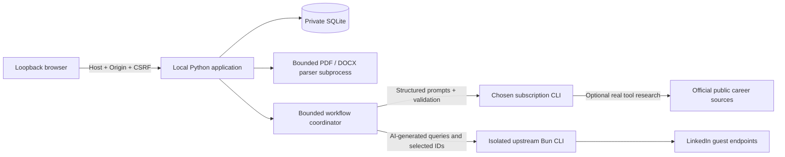

# Architecture and implementation decisions

V2 Phase 1 adds an approval-gated private-runtime skill launcher and catch-up-only
execution mode while reusing the V1 AI/data/source boundaries. See
[V2 decision and acceptance evidence](V2_PHASE1.md). The sections below describe
the preserved V1 design; its automatic/native scheduler is disabled in skill mode.

## Accepted V1 shape

One Windows-first loopback process, one local SQLite database and native browser UI. A standard-library `ThreadingHTTPServer` serves a fixed asset allowlist and guarded JSON endpoints; it is deliberately unsuitable for remote hosting or multi-user production. FastAPI/React were considered, but would add a framework/build/dependency layer without a necessary V1 capability. No cloud backend, Docker, vector store, autonomous multi-agent runtime or external account pipeline.

Python 3.11+, SQLite, pypdf and jsonschema are sufficient for the application. Bun runs the attributed, pinned upstream source tool. Codex/Claude Code subscription CLIs supply intelligence. The CLI is a process boundary, not an API billing bridge: no fallback key or token collection.

## Ownership

`providers.py` discovers direct executables, checks supported subscription authentication, disables inherited API-key variables, isolates call working directories, restricts tools and validates common schemas. `contracts.py` defines profile, plan, triage, research, evaluation and learning shapes. Every AI subprocess has a four-minute deadline, bounded output and cancelable process-tree termination; authentication checks have a shorter deadline. No automatic provider retry/fallback. CLI option support is version-dependent and unsupported invocations fail visibly.

`hunter.py` loads career context and explicit feedback, asks AI to learn cautiously, plan queries, select candidates, expand within budgets, select again after expansion, and evaluate every retrieved description. It stores observations before evaluation, so failures do not lose discoveries. Exact source/CV quote checks and unchanged user hard-requirement checks gate persistence. New assessments use natural-language preferences and evidence without a composite weighted score. Historical scores are preserved and labeled legacy. No keyword matching or Python career classifier exists. Unknown dimensions remain null. Interpretation/evaluation is fallible.

`linkedin.py` validates AI arguments and verified numeric identities, checks TTL caches before network, enforces persistent spacing/budgets/stops, invokes upstream search/detail and validates returned structure before caching success. Upstream safety changes are isolated and documented. No listing is called OPEN from upstream `isActive=true`.

`store.py` owns transactions and a versioned schema. `jobs` uses stable source identities; independent application events and explicit feedback preserve history. Observations identify new/seen per run. Runs persist running/completed/partial/failed/canceled/skipped outcomes, and a partial unique index permits only one running search. One process lock covers the database across GUI and scheduled entry points. Interrupt recovery refuses to infer a completed request. Corrupt/unsupported established databases are retained and rejected.

`server.py` serializes mutations and refuses profile/CV/feedback/learning/source-policy edits during an active AI operation. Assessments carry profile and preference-revision signatures; changes expose stale assessments, while changed descriptions invalidate them. Application status changes are separate and can persist during a search. AI tasks run in bounded background threads; the browser polls actual progress, and cancellation reaches the subprocess.

`schedule.py` checks local wall-clock due slots once per local day, including weekly weekday/time. The application records an attempt before starting; failures do not retry repeatedly. A process lock and database unique index prevent overlapping native/GUI runs. Native task creation is a separately confirmed fixed `schtasks` invocation with no overwrite; logged-in/on-machine runtime only.

## Secondary source boundary

Actual Codex JSONL web actions prove a tool was invoked, not that model-proposed description text equals a retrieved page. Claude JSON structured results expose even less tool evidence. Until an adapter can supply a successful fetch's actual complete text, secondary imports are refused and shown as unverified. `fetched_pages` is an intentionally unsupported telemetry capability in V1, not populated from model prose or query URLs. The research contract and source verifier are ready for a future documented trace capability; no hidden direct scraper fills this gap.

## UI and private state

Native DOM construction uses `textContent`, not untrusted HTML. Links allow only HTTPS without embedded credentials; assets have CSP and no-store headers. All API routes require exact loopback Host/Origin; writes additionally require a random CSRF token. The default private database is `.private/state.sqlite3`; upload paths are generated locally and never supplied by model output. Upload parsing occurs in a time-bounded subprocess. This local app is not an isolation boundary against same-user programs; no application-level encryption or hard parser memory limit is claimed.

Canonical skill instructions and one workflow reference are shared through platform-supported thin adapters. They guide the application, not a separate intelligence/data implementation. The skills do not authorize publication, native tasks or changes to unrelated projects.

## Changes needing new decisions

Provider CLI telemetry capable of verifiable secondary page content; live Claude support; real browser visual/accessibility QA; end-user prerequisite bootstrap/distribution signing; parser memory isolation; native task update/removal UX; release upgrade migrations. macOS/Linux remain feasible but unverified. No Outlook, auto-applying or off-machine scheduling is included.

## V2 Phase 2 market state

Phase 2.1 distribution is described in [second-user setup](INSTALL_CODEX_DESKTOP.md)
and [verification](V2_PHASE2_1.md). A reviewed public source archive stays separate
from the user workspace. Code hashes, collisions and database locks guard upgrades;
`.private` is preserved. Supported user skill discovery points to the exact canonical
checkout. Optional private Codex CLI bootstrap is separately consent-gated/checksummed
with process-only PATH. Official CLI browser login and real inference are separate
from Desktop login. Python/source/AI boundaries and database version 2 are preserved.

See [Phase 2 boundaries and migration](V2_PHASE2.md). `markets.py` validates configurable country profiles and exact query-location boundaries; explicit country tokens are source evidence, while provenance/cities are not country verification. Additive schema version 2 retains every original row and creates a verified consistent backup before migration. Market assessment and feedback scope tables share global job identities/application history. Regional revisions and learned preferences are separate; explicitly global feedback can affect all markets. One run, one LinkedIn transport, fair quotas and persistent spacing/stops cover Search all. Stale recommendations remain visible until validated replacement. Skill mode retains catch-up reminders only.
