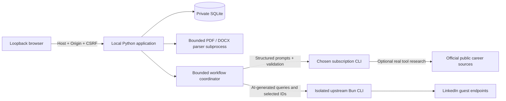

# Active weekly-research workflow

See [foundation audit](FOUNDATION_AUDIT.md). Version 5.3 uses `SessionSearch` and
an atomic SQLite search-session boundary. Current results/caches/runs are disposable;
`job_history`, `history_application_events`, `outlook_evidence`, CV/goals and explicit
feedback are durable. Imported mail never teaches employer-rejection preferences.
Old workers cannot write into replacement sessions. Private anonymous briefs are
cached by knowledge signature before web research; raw career text and CV experience
records stay in private inference. Exact source/employer requisitions outrank URL
tracking differences; ID-less matches require corroborating content. Triage precedes
costly description recovery and assessment. Compact triage batches all finish before
source enrichment starts; stored AI priority order controls verification and assessment.
Each selected market gets one primary discovery pass, with broader avenues explicitly
deferred. Observed job-specific publisher sources precede consented LinkedIn detail
requests. Only active verified full descriptions enter final assessment, at most two
per call, with long descriptions isolated rather than truncating their requirements.
Observed alternate publication URLs and page-read bodies are retained separately
from snippets. Ready HTML/JobPosting pages share the controlled recovery identity gate
and retain their observation time. Source selection, access, parsing and identity
outcomes remain distinct; no missing URL is replaced by a guessed address or a new
per-job AI search. Unverified selected text keeps enrichment incomplete.
Assessment batches contain only consecutive jobs in global priority order sharing
the same market and verified/inferred country scope. A scope change ends the current
batch; a later job from the earlier market cannot jump ahead of intervening candidates.
Each invalid assessment is withheld
independently; old recommendations cannot remain active after failed verification.
The browser has Recommended and All Opportunities, with a separate previous-leads
section. Earlier coordinators and acceptance documents below are historical references.

# V5 architecture

Current design and evidence: [V5 AI research](V5.md). `ResearchHunter` replaces the
legacy ATS-first coordinator for generation-5 workspaces. Native web observations
provide discovery evidence; a private anonymous-brief step excludes raw CV from web
context. Full descriptions/evaluations reuse strict controlled retrieval contracts.
Storage generation 5 refuses historical data; feedback is country-specific.

The following sections are retained as historical V1–V4.1 decisions.

# Architecture and implementation decisions

V2 Phase 1 adds an approval-gated private-runtime skill launcher and catch-up-only
execution mode while reusing the V1 AI/data/source boundaries. See
[V2 decision and acceptance evidence](V2_PHASE1.md). The sections below describe
the preserved V1 design; its automatic/native scheduler is disabled in skill mode.

## Accepted V1 shape

One Windows-first loopback process, one local SQLite database and native browser UI. A standard-library `ThreadingHTTPServer` serves a fixed asset allowlist and guarded JSON endpoints; it is deliberately unsuitable for remote hosting or multi-user production. FastAPI/React were considered, but would add a framework/build/dependency layer without a necessary V1 capability. No cloud backend, Docker, vector store, autonomous multi-agent runtime or external account pipeline.

Python 3.11+, SQLite, pypdf and jsonschema are sufficient for the application. Bun runs the attributed, pinned upstream source tool. Codex/Claude Code subscription CLIs supply intelligence. The CLI is a process boundary, not an API billing bridge: no fallback key or token collection.

## Ownership

`providers.py` discovers direct executables, checks supported subscription authentication, disables inherited API-key variables, isolates call working directories, restricts tools and validates common schemas. `contracts.py` defines profile, plan, triage, research, evaluation and learning shapes. Every AI subprocess has a four-minute deadline, bounded output and cancelable process-tree termination; authentication checks have a shorter deadline. No automatic provider retry/fallback. CLI option support is version-dependent and unsupported invocations fail visibly.

`hunter.py` loads career context and explicit feedback, asks AI to learn cautiously, plan queries, select candidates, expand within budgets, select again after expansion, and evaluate every retrieved description. It stores observations before evaluation, so failures do not lose discoveries. Exact source/CV quote checks and unchanged user hard-requirement checks gate persistence. New assessments use natural-language preferences and evidence without a composite weighted score. Historical scores are preserved and labeled legacy. No keyword matching or Python career classifier exists. Unknown dimensions remain null. Interpretation/evaluation is fallible.

`linkedin.py` validates AI arguments and verified numeric identities, checks TTL caches before network, enforces persistent spacing/budgets/stops, invokes upstream search/detail and validates returned structure before caching success. Upstream safety changes are isolated and documented. No listing is called OPEN from upstream `isActive=true`.

`store.py` owns transactions and a versioned schema. `jobs` uses stable source identities; independent application events and explicit feedback preserve history. Observations identify new/seen per run. Runs persist running/completed/partial/failed/canceled/skipped outcomes, and a partial unique index permits only one running search. One process lock covers the database across GUI and scheduled entry points. Interrupt recovery refuses to infer a completed request. Corrupt/unsupported established databases are retained and rejected.

`server.py` serializes mutations and refuses profile/CV/feedback/learning/source-policy edits during an active AI operation. Assessments carry profile and preference-revision signatures; changes expose stale assessments, while changed descriptions invalidate them. Application status changes are separate and can persist during a search. AI tasks run in bounded background threads; the browser polls actual progress, and cancellation reaches the subprocess.

`schedule.py` checks local wall-clock due slots once per local day, including weekly weekday/time. The application records an attempt before starting; failures do not retry repeatedly. A process lock and database unique index prevent overlapping native/GUI runs. Native task creation is a separately confirmed fixed `schtasks` invocation with no overwrite; logged-in/on-machine runtime only.

## Secondary source boundary

Actual provider web actions prove tool activity, not model-proposed page text. Phase 3 uses
AI only to locate public source URLs, then `sources.py` fetches real text in a bounded child
worker. HTTPS DNS answers must all be public; numeric IP is pinned and original TLS host
verified, closing DNS rebinding. No proxies/auth/cookies, bounded bytes/deadlines, robots
policy, safe same-host redirects and persistent publisher-family stops. LinkedIn denial
blocks LinkedIn; independent employer ATS publication remains permitted. Each ATS
publisher's denial covers its own board/API routes. Documented read-only
Greenhouse/Lever/EU/Ashby/SmartRecruiters/Workable APIs and JobPosting JSON-LD provide
source facts; Lever/Ashby require fetched employer
ownership because their feeds omit employer names. Exact employer/title/locality/country
and any known requisition, unique candidate and real full text gate association.
Original identity/history remain; separate description URL/hash/time/identity evidence
is stored. Provider-generated description prose never populates fetched-page evidence.
`recovery.py` shares Hunter's one-run/cancel gate and existing scoped evaluation contract.
Schema 2 remains unchanged; description states/evidence use existing job JSON payloads.

## UI and private state

Native DOM construction uses `textContent`, not untrusted HTML. Links allow only HTTPS without embedded credentials; assets have CSP and no-store headers. All API routes require exact loopback Host/Origin; writes additionally require a random CSRF token. The default private database is `.private/state.sqlite3`; upload paths are generated locally and never supplied by model output. Upload parsing occurs in a time-bounded subprocess. This local app is not an isolation boundary against same-user programs; no application-level encryption or hard parser memory limit is claimed.

Canonical skill instructions and one workflow reference are shared through platform-supported thin adapters. They guide the application, not a separate intelligence/data implementation. The skills do not authorize publication, native tasks or changes to unrelated projects.

## Changes needing new decisions

Live Claude support; complete browser accessibility QA; distribution signing; parser memory
isolation; native task update/removal UX; future release DB migrations. macOS/Linux remain
unverified. No Outlook, auto-applying or off-machine scheduling is included.

## Phase 3 update boundary

Version metadata checks use only the fixed public GitHub Releases endpoint. No private
context or workspace ID is transmitted. Startup notification is opt-in. Stable download
requires exact release asset/commit and independently reviewed SHA before staging.
`updates.py` validates all package paths/inventory/hashes, locks a closed managed workspace,
verifies old code plus private byte hashes and SQLite schema/rows, journals code replacement,
rolls back copying errors and retains interrupted transactions for explicit recovery. The
journal-aware launcher is copied first; startup refuses incomplete replacements. The same
private path, runtime, skill association and provider login remain. No automatic DB restore,
schema change, silent download/update, branch-tip stable distribution or release publication.

## V2 Phase 2 market state

Phase 2.1 distribution is described in [second-user setup](INSTALL_CODEX_DESKTOP.md)
and [verification](V2_PHASE2_1.md). A reviewed public source archive stays separate
from the user workspace. Code hashes, collisions and database locks guard upgrades;
`.private` is preserved. Supported user skill discovery points to the exact canonical
checkout. Optional private Codex CLI bootstrap is separately consent-gated/checksummed
with process-only PATH. Official CLI browser login and real inference are separate
from Desktop login. Python/source/AI boundaries and database version 2 are preserved.

See [Phase 2 boundaries and migration](V2_PHASE2.md). `markets.py` validates configurable country profiles and exact query-location boundaries; explicit country tokens are source evidence, while provenance/cities are not country verification. Additive schema version 2 retains every original row and creates a verified consistent backup before migration. Market assessment and feedback scope tables share global job identities/application history. Regional revisions and learned preferences are separate; explicitly global feedback can affect all markets. One run, one LinkedIn transport, fair quotas and persistent spacing/stops cover Search all. Stale recommendations remain visible until validated replacement. Skill mode retains catch-up reminders only.

